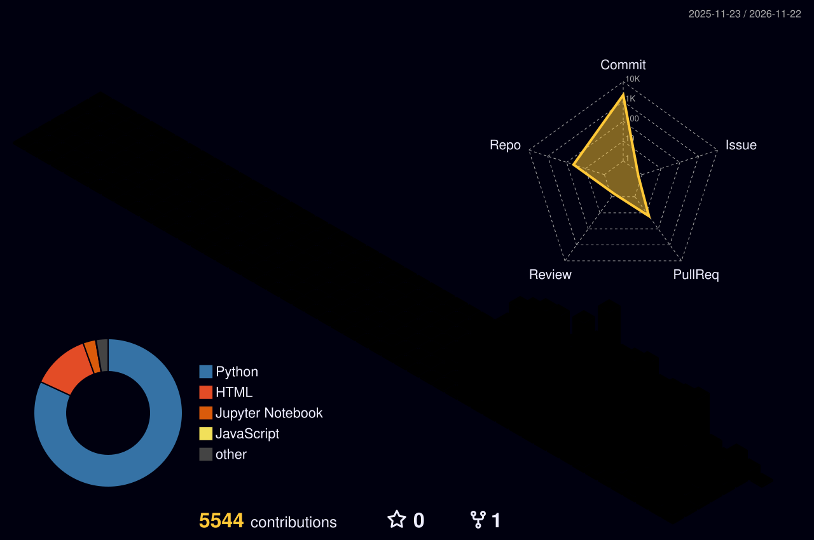

<h3>전기·설비 현장에서 AI로, 현장 사람과 AI를 잇는 도구를 만듭니다 </h3>

## 안녕하세요, 심성욱입니다

## 📌 고정한 프로젝트

| 프로젝트 | 무엇인가 | 결과 |
|---|---|---|
| [monthly-ai-retro](https://github.com/SKN35shimsungwook/monthly-ai-retro) | 네 곳의 AI 대화 기록과 GitHub 기록을 모아 제가 AI를 쓰는 버릇을 측정하는 회고 에이전트 (LangGraph) | 메시지 2,701개 분석, 끝난 기준 6.0%·증거 요구 7.5% |
| [skill-scout](https://github.com/SKN35shimsungwook/skill-scout) | 제 대화를 분석해 필요한 스킬·플러그인을 매일 아침 디스코드로 추천 | 추천은 규칙 기반이라 토큰 0, 대화 원문은 PC 밖으로 나가지 않음 |
| [todo-keeper](https://github.com/SKN35shimsungwook/todo-keeper) | 끝내지 않은 일을 다음 날 아침 다시 보여 주는 Claude Code 스킬 | 시험 15개 |
| [resume-agent](https://github.com/SKN35shimsungwook/resume-agent) | 제가 정리한 경험 카드의 사실만 쓰는 이력서·자소서 도우미, 5차 검증 | 가상 지원자 30명 시험 평균 59점 → 78점 |
| [langchain-migration-helper](https://github.com/SKN35shimsungwook/langchain-migration-helper) | 구버전 LangChain 코드를 최신 버전으로 바꾸는 팀 챗봇 (저는 결과 화면과 성능 평가 담당) | 변환 통과율 0% → 57%, 실행 기준 87% |
| [SKN35-4th-4Team](https://github.com/SKN35shimsungwook/SKN35-4th-4Team) | 위 챗봇을 Django·AWS로 옮긴 팀 프로젝트 (저는 화면과 발표 담당) | |

## 🛠 다루는 기술

| 분류 | 기술 |
|:---|:---|
| **언어** |     |
| **AI·에이전트** |      |
| **화면·서버** |    |
| **데이터베이스** |     |
| **배포·도구** |     |
| **현장** |    |

## 📊 GitHub 활동

  

  
  

## 🔭 요즘 관심 있는 것

- 현장에서 일하는 사람과 AI를 잇는 일: 기준과 매뉴얼을 근거와 함께 찾아 주는 도구
- AI 결과 검증: 근거가 없는 수치는 통과시키지 않는 장치

